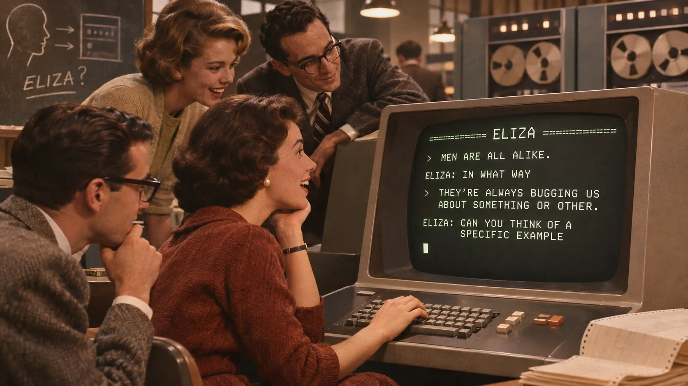
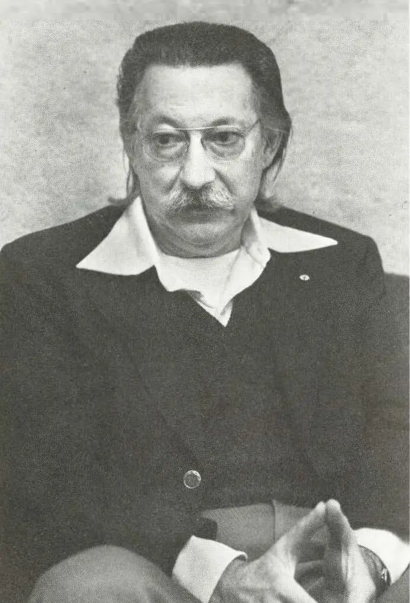
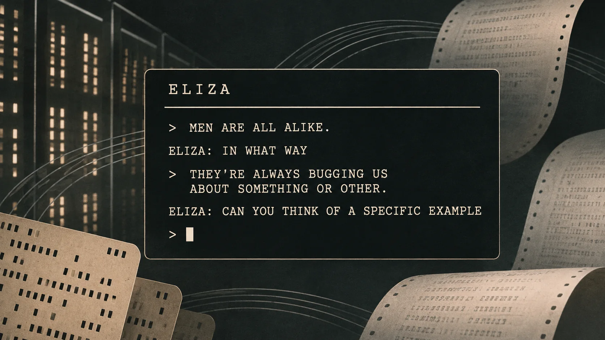
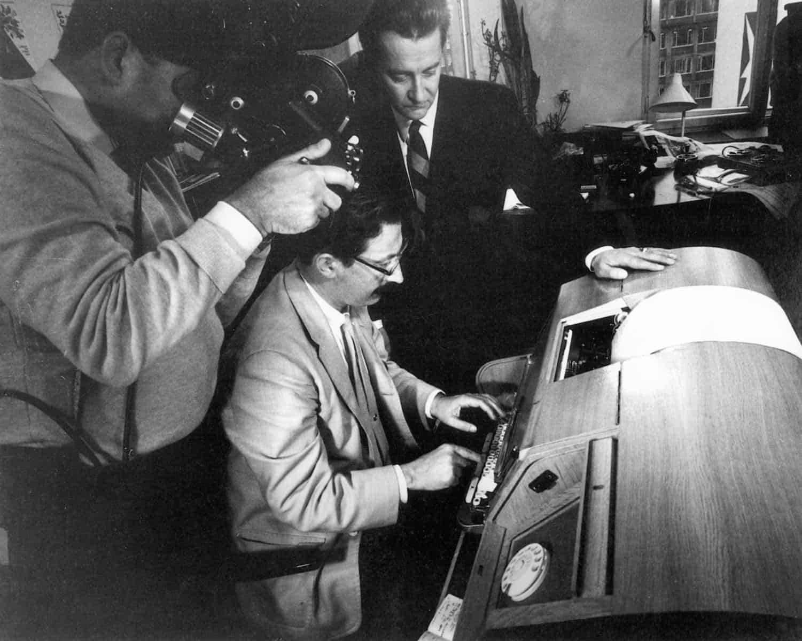

<!-- DRAFT ONLY: references docs/editorial-drafts/eliza/images, excluded from normal site builds. On approval, move images to /assets and revise all three paths. -->

<figure class="journal-archive-gallery">
  
  <figcaption>An imagined encounter with ELIZA in the 1960s. Editorial illustration.</figcaption>
</figure>

A sample conversation published in 1966 began with someone telling a computer that men were all alike. The computer replied, &quot;IN WHAT WAY&quot;. Soon it was asking for a specific example, as though it were genuinely interested in the person's problems.

You could have an exchange like that with your phone today and barely notice. But this was <strong>1966</strong>. The Beatles were still together, nobody had walked on the Moon, and the program behind the exchange ran on an IBM 7094 mainframe at MIT.

Its name was <strong>ELIZA</strong>. It wasn't thinking, feeling, or secretly planning to take over the world. It was matching patterns in text. Yet people sometimes spoke to it as though it understood them.

That reaction is what makes its story worth revisiting sixty years later. The fact that researchers recently recovered its original code makes it even better.

<h2>Meet Joseph Weizenbaum</h2>

ELIZA was created by computer scientist <strong>Joseph Weizenbaum</strong> at the Massachusetts Institute of Technology. He would later become as well known for questioning how much authority we give computers as for making one seem conversational. He described ELIZA in a January 1966 paper for <em>Communications of the ACM</em>, titled <em>ELIZA: A Computer Program for the Study of Natural Language Communication Between Man and Machine</em>.

Computing looked rather different then. ELIZA ran on MIT's Compatible Time-Sharing System, or CTSS. Instead of opening a chat app, users communicated through text terminals, sometimes using a Teletype machine that printed the exchange onto paper.

Weizenbaum named his program after Eliza Doolittle from George Bernard Shaw's <em>Pygmalion</em>, a character whose speech is transformed through instruction. The name suited a program that could be given different conversational scripts.

<figure class="journal-archive-gallery">
  
  <figcaption>Joseph Weizenbaum, 1982. <a href="https://commons.wikimedia.org/wiki/File:Weizenbaum_1982.jpg">Rochester Institute of Technology</a> / Wikimedia Commons.</figcaption>
</figure>

Its most famous script was called <strong>DOCTOR</strong>, which imitated the questioning style of a nondirective psychotherapist. The program encouraged the person to keep talking, reflected their own words back at them, and sometimes asked about family or feelings.

There was a clever practical reason for that choice. A therapist-style conversation could sound convincing without the computer offering much factual information at all. Asking someone to elaborate is surprisingly effective. Entire meetings have been sustained by less.

There is one distinction worth remembering: <strong>ELIZA was the engine, and DOCTOR was a script it could run.</strong> Many later retellings treat the two as though they were the same program.

<h2>How could something so simple seem so human?</h2>

ELIZA wasn't trained on books, websites or recorded conversations. It didn't predict the next word using a neural network. It followed rules that Weizenbaum and the script author had written explicitly.

A simplified version of its process looks like this:

<strong>Your sentence → Find an important keyword → Match a phrase pattern → Rearrange part of the input → Print a reply</strong>

In Weizenbaum's published conversation, a person says, <em>&quot;Perhaps I could learn to get along with my mother.&quot;</em> ELIZA responds: <strong>&quot;TELL ME MORE ABOUT YOUR FAMILY&quot;</strong>.

To a human reader, it looks like a relevant follow-up question. To ELIZA, the family-related wording triggers a rule that supplies an appropriate-looking reply.

The original system also had keyword priorities, different response choices and a limited mechanism for returning to something the user had said earlier. It was more sophisticated than a single collection of &quot;if this word, say that sentence&quot; commands, but it never needed to understand what a mother or family actually was.

<figure class="journal-archive-gallery">
  
  <figcaption>ELIZA's 1966 conversation, recreated as an editorial illustration.</figcaption>
</figure>

The surprising part is how much meaning <em>we</em> supply. When a machine asks about our family immediately after we mention our mother, we're inclined to imagine that it has followed the conversation. Sometimes all it has done is spot a keyword.

<h2>The woman who asked for privacy</h2>

The reaction to ELIZA caught its creator off guard.

In his 1976 book <em>Computer Power and Human Reason</em>, Weizenbaum recounted an incident involving his secretary. She had watched him work on ELIZA and understood that it was a program. Yet, after a few exchanges with DOCTOR, she asked him to leave the room so she could speak to the machine privately.

It's a striking anecdote, but it should be presented accurately: this is <strong>Weizenbaum's own recollection</strong>, written years later, not an independently documented laboratory experiment. It is also separate from the &quot;Men are all alike&quot; demonstration in his 1966 paper.

Weizenbaum became troubled by how readily people could attribute understanding and authority to a system that had neither. He also found that some users regarded their conversations as personal even though they were interacting with software.

Does any of that sound familiar? We now discuss emotional attachment to chatbots, private conversations with assistants and the risk of treating fluent replies as trustworthy judgment. ELIZA raised versions of those questions decades before the smartphone.

<h2>The original code went missing</h2>

ELIZA became famous, but the code behind the original version did not circulate in the way the name did.

Weizenbaum's 1966 paper described the algorithm and printed the DOCTOR script, not a complete listing of the ELIZA engine. Other programmers recreated versions in different languages. Bernie Cosell produced a particularly influential Lisp implementation, and later home-computer versions helped keep ELIZA alive in popular memory.

<figure class="journal-archive-gallery">
  
  <figcaption>Joseph Weizenbaum at an early computer terminal.</figcaption>
</figure>

For years, the originals remained difficult to study. Then, in <strong>2021</strong>, computer scientist <strong>Jeff Shrager</strong>, working with MIT archivist <strong>Myles Crowley</strong>, located a listing among Weizenbaum's archived papers. A folder marked <em>Computer Conversations</em> contained the original MAD-SLIP source and an early DOCTOR script.

It wasn't a forgotten GitHub repository, obviously. It was printed source code in an archive. A rather good reminder that the cloud has not always been the universal answer to file management.

With permission from Weizenbaum's estate, the original code was released under a <strong>CC0 public-domain dedication</strong>. Researchers could finally examine the actual instructions rather than relying entirely on later reconstructions.

There was another important detail: the recovered printout came from <strong>1965</strong>. It wasn't identical to the more developed ELIZA described in the 1966 paper. Some features changed between versions, so the original source and the published description shouldn't be treated as interchangeable.

You can <a href="https://findingeliza.org/code.html">browse the recovered source</a> or examine the <a href="https://github.com/critical-code-studies/ELIZA/blob/main/sources/ELIZA-1965b.mad">MAD-SLIP transcription</a>. No programming background is required to appreciate how much history can hide in a pile of printed pages.

<h2>Getting a sixty-year-old program running again</h2>

Finding code from 1965 is one thing. Running it is another.

The original ELIZA was written in <strong>MAD-SLIP</strong>, using the Michigan Algorithm Decoder language with Symmetric List Processor facilities. It expected an IBM 7094, a particular operating system and supporting routines that modern computers don't provide out of the box.

Researchers <strong>Rupert Lane, Anthony Hay, Arthur Schwarz, David M. Berry and Jeff Shrager</strong> documented the effort to reconstruct the program. The team transcribed and repaired old code, restored missing supporting functionality, and ran it on an emulated IBM 7094 using a reconstructed CTSS environment.

Some of the printouts were difficult to read. There were hundreds of lines of unfamiliar code and small errors that could stop everything working. One character in an assembly routine could matter. Anyone who has spent an evening looking for a misplaced bracket will sympathise, although this was a substantially more ambitious debugging session.

On <strong>21 December 2024</strong>, the restored ELIZA ran again. The team reported that about <strong>96% of its working ELIZA and SLIP code</strong> remained as recovered from the archive.

It wasn't an untouched binary somehow waking from a sixty-year nap. It was a careful reconstruction, with the changes documented. The result made it possible to see how the historical program actually behaved.

And naturally, it had bugs.

<h2>They even kept the bugs</h2>

One restoration finding was especially memorable. Type a sentence involving the number <code>999</code>, such as <em>&quot;you are 999 today&quot;</em>, and the recovered version could crash because of its numerical-input handling.

The researchers documented the issue rather than quietly polishing every imperfection away. For a historical restoration, preserving how the program behaved can be just as useful as making it more robust.

They also uncovered an interactive editing facility that allowed a user to modify ELIZA's script while the system was running. In today's language, it was possible to alter aspects of the chatbot's behaviour from within the program itself.

That doesn't make ELIZA an early large language model. It makes it an interesting, adaptable piece of 1960s software whose original features were partly lost in retellings.

If you're curious about the reconstruction, the <a href="https://arxiv.org/abs/2501.06707">ELIZA Reanimated research paper</a> and <a href="https://github.com/rupertl/eliza-ctss">runnable CTSS restoration</a> are the best places to continue.

<h2>From ELIZA to modern AI</h2>

It's tempting to say ELIZA was a primitive ChatGPT. I don't think that's quite right.

Both systems talk to people through language, but the machinery is fundamentally different. ELIZA selected and rearranged responses using programmed rules. Today's large language models learn patterns from enormous datasets and generate language using neural networks, enabling far more flexible responses.

What connects them is not a shared technical architecture. It's how people react to them.

A fluent reply can make us feel that we're being understood. Sometimes that feeling helps make an interface comfortable and accessible. But the ease of a conversation is not, by itself, proof that a system understands the person having it, or deserves their trust.

Weizenbaum saw that tension when conversation with a machine still meant typing on a terminal connected to a mainframe.

Sixty years later, the question remains surprisingly current.

And that is why ELIZA deserves more than a footnote in the story of AI: not because it could think, but because it showed how easily a computer could make <em>us</em> think it did.

<h3>Sources and further reading</h3>
<ol>
<li>Joseph Weizenbaum, <a href="https://doi.org/10.1145/365153.365168"><em>ELIZA: A Computer Program for the Study of Natural Language Communication Between Man and Machine</em></a>, <em>Communications of the ACM</em>, January 1966.</li>
<li>Jeff Shrager, <a href="https://elizagen.org/original-eliza.html"><em>Original ELIZA: Rediscovery of the MAD-SLIP Source</em></a>, ELIZAGEN.</li>
<li>Rupert Lane, Anthony Hay, Arthur Schwarz, David M. Berry and Jeff Shrager, <a href="https://arxiv.org/abs/2501.06707"><em>ELIZA Reanimated</em></a>, 2025.</li>
<li>ELIZA Archaeology Project, <a href="https://findingeliza.org/doctor.html"><em>The DOCTOR Script and Original Dialogue</em></a> and <a href="https://findingeliza.org/code.html"><em>The Program</em></a>.</li>
<li><a href="https://github.com/critical-code-studies/ELIZA/blob/main/sources/ELIZA-1965b.mad">Original recovered MAD-SLIP source</a> and <a href="https://github.com/rupertl/eliza-ctss">historical CTSS reconstruction</a>.</li>
<li>Joseph Weizenbaum, <em>Computer Power and Human Reason: From Judgment to Calculation</em>, 1976 (source of the secretary anecdote).</li>
</ol>

<em>Editorial note: The first illustration is an imagined historical scene and the second is a designed conversation graphic, not archival photographs. Historical photographs and reconstructions are separately identified in their captions.</em>

