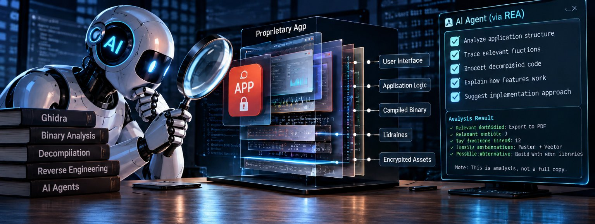
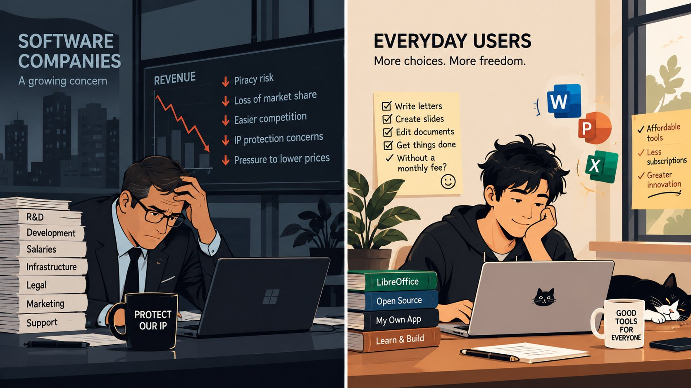

<figure class="journal-archive-gallery">
  
  <figcaption>AI-assisted software analysis. Conceptual artwork, not an actual REA interface or tested workflow.</figcaption>
</figure>

Imagine spending months building an application, refining its features, fixing bugs and making everything work smoothly. Then someone arrives with an AI assistant and asks it to figure out how your software works.

Not exactly the kind of morning a developer looks forward to.

A GitHub project called **Reverse Engineer Anything (REA)** is drawing attention to an intriguing possibility: AI agents can assist with the specialized work of investigating how software behaves, even when the original source code is unavailable.

For software companies, that raises uncomfortable questions. For independent developers, it opens interesting possibilities. And for people tired of paying monthly subscriptions for everyday tools, it adds another dimension to the debate about affordable software.

But does making reverse engineering easier mean the end of paid applications? Not remotely.

## What exactly is Reverse Engineer Anything?

Reverse engineering is not new. Developers and security researchers have spent decades analyzing software to understand its behavior, investigate vulnerabilities, recover compatibility information and preserve older systems.

Traditionally, the process has required specialized knowledge, patience and tools that can be intimidating to newcomers.

[REA on GitHub](https://github.com/morluto/rea) aims to make aspects of that work more approachable by connecting AI coding agents with reverse-engineering workflows.

An agent can help inspect a program, investigate relevant functions and explain findings. What it can accomplish depends on the application, the available tools and the quality of the analysis.

**REA does not magically recover the original source code or perfectly clone every paid application.** Studying a feature and rebuilding a reliable alternative are two different jobs.

AI did not invent the screwdriver. It simply handed one to considerably more people.

And some of those people are now examining how the toolbox was built.

## Why this matters to independent developers

Imagine discovering a music player with a beautifully smooth album-art transition. You want to understand the technical approach, not steal its branding or redistribute its code.

Previously, investigating a compiled application could require substantial reverse-engineering expertise. AI-assisted analysis may help you identify relevant behavior and explore possible ways to implement a similar interaction independently.

That does not remove the need to design, code, test and maintain your own solution. Nor does it guarantee access to everything that happens inside an application.

A polished interface might depend on proprietary libraries, online services, licensing infrastructure or data that cannot be reconstructed simply by inspecting the software installed on a device.

Still, reducing the barrier to technical investigation could be valuable for learning, interoperability, security research and software preservation.

## Why software companies might be concerned

Software development costs money. Behind a useful application are engineering, design, testing, infrastructure, security maintenance and customer support.

A distinctive feature can represent months of experimentation. If competitors can more easily understand and reproduce its behavior, the original developer may lose part of a competitive advantage.

Smaller software businesses are especially exposed when a single feature is central to their product.

There are also intellectual-property concerns. Studying how software behaves does not give someone permission to copy protected source code, artwork, branding or other proprietary material.

AI-assisted reverse engineering can support legitimate research, but it could also make some forms of misuse easier.

Developers deserve to be paid for their work. Making software easier to analyze should not become an excuse to appropriate someone else's work.

## Consumers have a point, too

<figure class="journal-archive-gallery">
  
  <figcaption>Software makers and everyday users have different interests in this debate. Illustration only; not a chart of actual financial results.</figcaption>
</figure>

Now consider the other side.

Need a productivity suite? Subscription. Cloud storage? Subscription. A design tool? Another subscription.

At this rate, somebody might eventually introduce a monthly plan for the calculator. Hopefully, addition remains available on the free tier.

Subscriptions are not inherently unreasonable. Software needs maintenance, and recurring payments can support cloud services, updates and customer support.

The frustration begins when the price or commitment feels disproportionate to what a user actually needs.

Someone who writes a few letters or prepares an occasional presentation may not want another recurring expense. That is a legitimate preference, not an argument that software should be free.

Free alternatives such as [LibreOffice](https://www.libreoffice.org/) already show that capable productivity tools can exist without mandatory monthly payments. Independent developers can also offer focused, affordable utilities, including one-time-purchase products where the business model is sustainable.

REA does not bypass subscription charges or unlock paid features. Its relevance is more indirect: tools that help developers understand software may also help them create competing, independently implemented alternatives.

## Is reverse engineering legal?

There is no universal yes-or-no answer.

The legal position depends on the country, the purpose of the investigation, the software license, copyright rules, contractual terms and the methods used.

Security research, interoperability, education and preservation can have legitimate grounds in appropriate circumstances. Unauthorized redistribution of protected code, circumvention of access controls or production of infringing copies can create legal problems.

Understanding an idea is not automatically the same as owning its implementation.

And even when AI writes the code, responsibility does not disappear. An AI-generated copyright problem is still a copyright problem. It simply arrives with better autocomplete.

Developers considering reverse-engineering work should check the rules that apply to their specific use case rather than assuming an open-source tool grants legal permission.

## Could this change the software industry?

Potentially, although the impact should not be exaggerated.

Reverse-engineering tools already exist, as do AI coding assistants. The interesting development is their integration into workflows that could make technical investigation more approachable.

That may help researchers analyze vulnerabilities, developers explore compatibility problems and enthusiasts study software that is no longer maintained.

But understanding how an application works is only one part of creating a successful product. Reliability, accessibility, security, updates and support still matter.

Reverse engineering might reveal how a door opens. It does not necessarily give you the architectural plans for the entire building.

## Perhaps the bigger debate is about pricing

This should not become a simple argument between greedy corporations and people who want everything for free.

Companies have legitimate reasons to protect their intellectual property. Independent creators need sustainable revenue. Consumers deserve fair pricing and meaningful choices.

A subscription can be excellent value when it provides continuing services or improvements. A one-time purchase can be a better fit for a simple offline utility. Open-source software can serve users who prioritize freedom, transparency or cost.

No single model works for everything.

What matters is whether pricing reflects the value delivered rather than merely the opportunity to collect recurring payments.

## Final thoughts

As someone who works in medicine but has pursued software development as a personal passion for years, I find tools like REA fascinating.

Learning how software works has always been an important part of becoming a better developer. Making that learning process more accessible is promising, provided it respects the work and rights of other creators.

I also believe useful software should be accessible to people who cannot justify a collection of monthly subscriptions.

Those positions are not contradictory.

**The future should not be about copying everyone's software for free. It should be about making good software easier to build, fairly priced and more accessible to the people who need it.**

And perhaps, somewhere along the way, we can keep the calculator free.

## Sources and further reading

1. [Reverse Engineer Anything: Project repository](https://github.com/morluto/rea)
2. [LibreOffice: Free and open-source productivity suite](https://www.libreoffice.org/)
3. [GNU Project: Free software philosophy](https://www.gnu.org/philosophy/free-sw.html)

### Editorial note

This article discusses the potential implications of AI-assisted reverse engineering. The illustrations are conceptual. Sanat Utility Studio has not independently benchmarked REA or verified claims that it can reproduce specific commercial applications. The legal discussion is general information, not legal advice.
