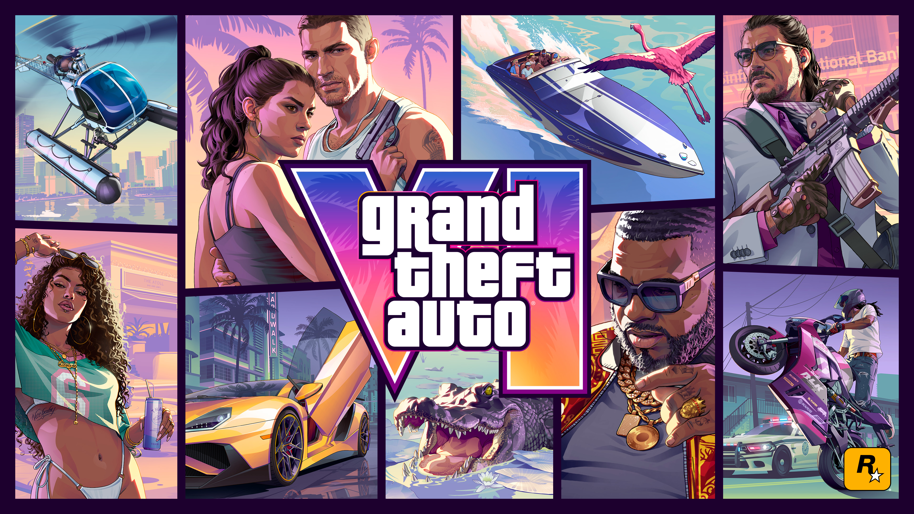
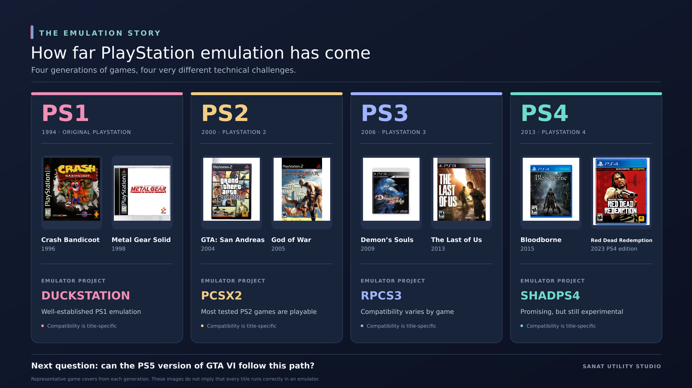

<figure class="journal-archive-gallery">
  
  <figcaption>Official Grand Theft Auto VI artwork © Rockstar Games, used here for editorial commentary.</figcaption>
</figure>

Rockstar has confirmed that *Grand Theft Auto VI* is arriving on November 19, 2026, for PlayStation 5 and Xbox Series X and Series S. For PC players, the announcement came with one familiar omission: no PC version, and no official release date for one.

If you've followed Rockstar for a while, this probably sounds familiar. *GTA V* originally reached consoles in September 2013, but its PC version arrived in April 2015. *Red Dead Redemption 2* also made PC players wait after its console debut. Waiting is practically a side activity in Rockstar games, except this one happens before you get to play.

But there's an interesting question floating around gaming circles. What if hackers and emulator developers manage to get the PS5 version of GTA VI running on a PC before Rockstar releases a proper Windows version?

I can see why people are asking. We already run plenty of older PlayStation games on PCs remarkably well. Why couldn't the same thing happen here?

## We've seen old PlayStation games come to PC before

Think back to the original PlayStation. Games like *Crash Bandicoot* and *Metal Gear Solid* were designed for a specific console, yet today the likes of DuckStation can reproduce that old PlayStation experience on modern computers with impressive accuracy.

The PlayStation 2 has a similar story. PCSX2 has spent years improving compatibility with a huge library of games, including an era defined by *God of War*, *Shadow of the Colossus*, and *GTA: San Andreas*. To be clear, *San Andreas* also had an official PC release. Running that native PC version and emulating its PS2 version are two very different things.

The PlayStation 3 presented another difficult challenge, but RPCS3 has made remarkable progress. And now there's shadPS4, an experimental PlayStation 4 emulator that can run selected games, including *Bloodborne*, while many other titles still face serious compatibility problems.

That progress deserves respect. These projects were not built by someone pressing a magical “convert to PC” button. They're the result of years of research, testing, bug reports, and the sort of patience I usually associate with people restoring vintage cars.

There's also an important catch: we are looking at those older consoles with the benefit of time. The fact that a PS2 game can run well on a computer in 2026 doesn't mean a massive PS5 game will follow the same path within weeks or months.

<figure class="journal-archive-gallery">
  
  <figcaption>A quick look at how PlayStation emulation has developed over the years. This is an editorial overview, not a claim that every title works perfectly.</figcaption>
</figure>

## A PS5 jailbreak isn't a PC version

This is where a lot of online discussions get mixed up.

A *jailbreak* generally means finding a way around restrictions on a console so that it can run code Sony did not originally authorize. An *emulator* is software that attempts to reproduce enough of the console's behavior on different hardware to run its games. A *native PC port* is a version that the developer has adapted for Windows and PC hardware.

They are related topics, but they are not interchangeable.

Even if researchers find a way into a particular PS5 firmware version, they still have to deal with protected game data, console-specific operating system features, graphics instructions, memory behavior, and performance. The PS5 uses an AMD x86-64 processor, which is broadly familiar territory for PCs. That helps in some ways, but it does not mean a PS5 game is secretly a Windows application waiting to be unlocked.

Opening a locked door is an achievement. It doesn't automatically mean you can pick up the entire building and move it somewhere else.

And Sony isn't standing still. Console software gets security updates, while researchers continue looking for weaknesses. Sony even runs a PlayStation bug bounty program that encourages security researchers to report vulnerabilities. An exploit that works on one firmware version may not work on another, and an exploit alone still doesn't solve the emulation problem.

<figure class="journal-archive-gallery">
  
  <figcaption>Getting code to run on a console is only one step. Reproducing its game environment on a PC is a much larger challenge.</figcaption>
</figure>

## So how close is PS5 emulation?

There are experimental projects exploring PS5 emulation, just as there are developers steadily improving PS4 emulation. But I haven't found credible, reproducible evidence of GTA VI running on Windows through a PS5 emulator. Experimenting with the platform is one thing. Comfortably driving around Vice City on your gaming PC is quite another.

For context, shadPS4's own compatibility database still contains plenty of PS4 titles that only reach menus, partially enter gameplay, or fail to run. That's a previous-generation console. GTA VI is a visually ambitious open-world game built for newer hardware. It hardly looks like an easy first test case.

We should also be careful with the word “running.” A game displaying its opening logo is not the same as finishing the game at a stable frame rate with working audio, saves, missions, and controls. I've built enough small apps to know that something launching once and something working properly are two different milestones.

## Could a leaked build change everything?

Some people imagine a different shortcut: perhaps an unfinished PC build could leak, or someone could somehow turn the console files into a working Windows release.

But a leak would not magically remove the need for compatible code, dependencies, graphics support, and substantial testing. Rockstar has not announced a PC edition of GTA VI, either. Claims of a ready-to-play leaked Windows version should be treated with extreme suspicion unless there is extraordinary, verifiable evidence.

We also shouldn't confuse an official PC port with emulation. Rockstar's own engineers can make platform-specific changes, optimize performance, and fix issues using tools and source code that outside emulator developers simply do not have.

## The fake emulator problem is already here

Unfortunately, one part of the GTA VI PC story has moved much faster than actual emulation: scams.

Security researchers at Malwarebytes documented fake GTA VI demo websites impersonating Rockstar and directing visitors toward password-stealing malware. Huntress also investigated malicious files masquerading as leaked GTA VI downloads. These were not clever ways to play the game early. They were traps aimed at people eager enough to click.

So if a website claims to offer “GTA VI PC Emulator 2026,” a secret beta, or an installer that requires you to disable antivirus protection, stop there. A flashy download page, a progress bar, and a suspiciously confident YouTube tutorial do not make something real.

The irony is that creating a convincing fake download button is considerably easier than creating a functional PS5 emulator.

## My take: possible in theory, unlikely anytime soon

Could hackers achieve a technical breakthrough before Rockstar releases a PC version? Of course. Emulation has surprised people before, and I wouldn't underestimate the researchers working on these projects.

But if we're talking about a complete, stable, enjoyable version of GTA VI running through PS5 emulation on an ordinary gaming PC before an official Windows release, I wouldn't bet on it. Not with the current state of the technology, and certainly not based on videos promising miracles two weeks before the console launch.

I'm curious about what emulator developers manage next, so I'll keep an eye on their updates and Rockstar's announcements. But if a random site offers GTA VI for PC right now, I'm not clicking it.

PC gamers may have to wait. We can at least try not to get hacked while doing it.

---

## Sources and further reading

- [Rockstar Games: Grand Theft Auto VI official page](https://www.rockstargames.com/VI)
- [Rockstar Games: GTA V arrives on PC, April 14, 2015](https://www.rockstargames.com/newswire/article/25o2411812a31k/grand-theft-auto-v-is-now-available-for-pc)
- [Rockstar Games: Red Dead Redemption 2 PC announcement](https://www.rockstargames.com/newswire/article/9k1248838o2974/Red-Dead-Redemption-2-Coming-to-PC-November-5th)
- [DuckStation project](https://github.com/stenzek/duckstation)
- [PCSX2 compatibility database](https://pcsx2.net/compat/)
- [RPCS3 project](https://rpcs3.net/)
- [shadPS4 project and compatibility database](https://shadps4.net/compatibility/)
- [PlayStation: PS5 hardware specifications](https://blog.playstation.com/2020/03/18/unveiling-new-details-of-playstation-5-hardware-technical-specs/)
- [Sony: Product security and vulnerability reporting](https://www.sony.com/en/SonyInfo/product_security/)
- [Malwarebytes: Fake GTA VI demo websites](https://www.malwarebytes.com/blog/news/2026/08/fake-gta-6-extended-look-and-demo-sites-deliver-an-infostealer)
- [Huntress: Fake GTA VI downloads and malware analysis](https://www.huntress.com/blog/fake-gta6-download-malware-analysis)
