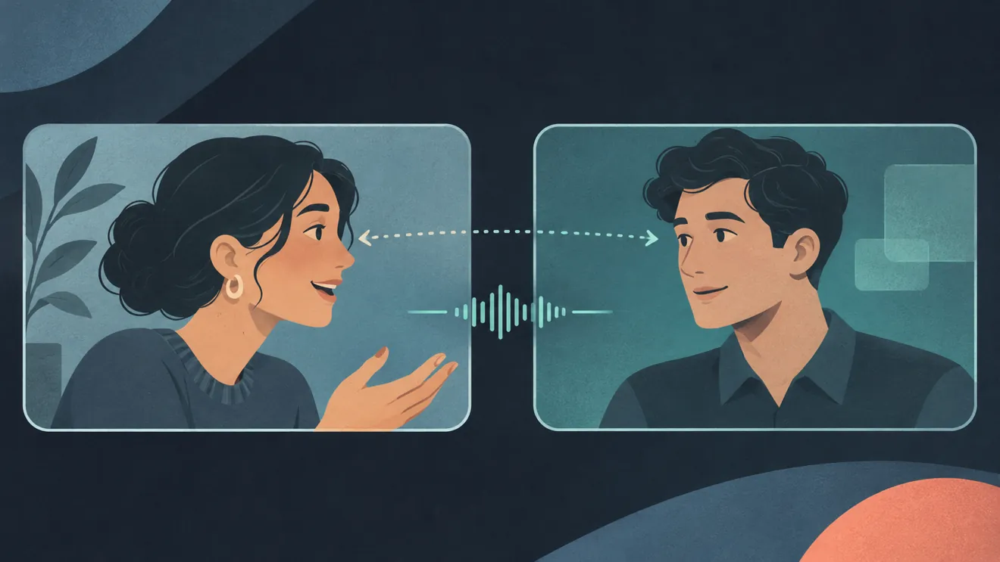

*A convincing video call, an AI that learned to talk by listening, a world that creates itself as you explore, a robot learning household chores, and brain signals turning into text. Five research projects I couldn't ignore.*

I follow AI developments partly out of curiosity and partly because I enjoy building software myself. Most announcements are easy to scroll past. A model gets faster, a benchmark improves, someone adds another impressive-looking chart.

Then, every so often, something makes me stop and watch the demonstration twice.

These five projects did exactly that. They're working on very different problems, and the ideas behind them are more interesting to me than another leaderboard update.

## 1. Griffin: Who exactly is on the other side of that video call?

**TAVUS** · [Official project and video demonstrations](https://www.tavus.io/griffin)

<figure class="journal-archive-gallery">
  
  <figcaption>Illustration: Griffin explores what happens when AI can respond to your voice, expressions, and pauses in real time.</figcaption>
</figure>

We're used to AI voices now. Some sound convincing until you interrupt them. Video is harder. People glance away, hesitate, smile, and sometimes say more with their faces than their words.

Tavus is tackling that with **Griffin**, a system that processes what you say and do while generating the other side of a video conversation. Its timing, expressions, and responses are meant to work together naturally.

One result caught my attention. In a Tavus study, 54 participants each had a one-minute video conversation without knowing their partner was AI. Afterwards, 26 of them, about **48%**, believed they had spoken to a real person.

It was a one-minute test with 54 people, and I'd be curious to see how Griffin holds up through a longer, messier conversation. The fact that nearly half of this group came away convinced is remarkable enough on its own. For now, Griffin-Lite is being tested in a limited research preview.

It's a strange thought. Someday, the difficult part of a video call might not be getting the camera to work. It might be knowing whether the person on screen is actually a person.

## 2. Dessa: A conversation model that learned by listening

**BLOCK** · [Listen to the official Dessa audio samples](https://block.xyz/dessa)

<figure class="journal-archive-gallery">
  
  <figcaption>Illustration: Dessa is designed to listen and speak at the same time, much like a natural conversation.</figcaption>
</figure>

Most voice assistants take turns. You speak, they process, then they reply. Sometimes it feels like talking over a walkie-talkie.

**Dessa**, from Block, takes a different route. According to its creators, it was trained from scratch using recordings of human conversations, without feeding it text transcripts or starting from a pretrained text model. In other words, it learned from voices rather than from written words.

It is also a *full-duplex* speech model. It can listen while speaking, react to interruptions, and offer those little acknowledgements that keep a conversation moving. Pauses, laughter, and overlapping speech are part of the point.

I like that approach. We focus on whether an assistant gets the answer right, but timing matters too. A correct reply delivered three seconds too late can feel strangely artificial.

Block has published audio samples and is giving a small group of safety researchers early access. I'd love to hear how it handles a conversation where someone keeps changing the subject halfway through a sentence. That's usually where the natural flow falls apart.

And yes, it would be nice if future voice assistants could understand the difference between a genuine question and someone just muttering at their computer after a failed build.

## 3. Genie 4: What if the game world didn't exist until you walked into it?

**GOOGLE DEEPMIND** · [Official research page and interactive examples](https://deepmind.google/blog/genie-4-a-new-generation-of-world-simulation/)

<figure class="journal-archive-gallery">
  
  <figcaption>Illustration: Genie 4 generates an interactive environment as someone explores and changes it.</figcaption>
</figure>

This one speaks directly to the gamer in me.

In a conventional video game, developers build the streets, forests, rooms, and countless details before you get there. **Genie 4**, announced by Google DeepMind in October 2026, approaches things differently.

It's a *world model*. Instead of merely producing a video for you to watch, it generates an environment you can explore and influence. Move through a scene, change the weather with a prompt, introduce a character, and the system attempts to simulate what happens next. It can generate sounds and dialogue along with the visuals.

Imagine describing an abandoned coastal town during a thunderstorm, then walking around it as the world responds to you. I know game developers would have a long list of practical questions. As a gamer, I'd mostly want to get my hands on it.

*Official demonstration: Google DeepMind, October 2026. Select the preview to watch the original video on YouTube.*

DeepMind says visual details can drift during longer sessions, and complex physical interactions still need work. Genie 4 is currently a research preview for selected testers. Watching even these early examples, I keep thinking about all the digital worlds I've explored over the years and what it would feel like to explore one that wasn't built in advance.

## 4. Helix 2.5: The robot that hasn't seen your house before

**FIGURE** · [Official research findings and demonstrations](https://www.figure.ai/news/helix-2-5-zero-shot-30-home-generalization)

<figure class="journal-archive-gallery">
  
  <figcaption>Illustration: Figure is testing whether one robot system can handle familiar chores in unfamiliar homes.</figcaption>
</figure>

Humanoid robots folding laundry are practically a standard feature of futuristic advertising. The tricky part is getting one to fold *your* laundry, in *your* house, with objects and furniture it has never encountered.

Figure's **Helix 2.5** research is interesting because it addresses that problem directly. The company tested a humanoid robot in **30 unfamiliar homes** on three jobs: tidying living rooms, folding towels, and making beds. The robot wasn't trained on the specific rooms or objects it would encounter in those tests.

*Official demonstration: Figure, September 2026. Select the preview to watch the original video on YouTube.*

Using what it learned somewhere new is called *generalization*. The real challenge begins when someone moves a table six inches to the left.

Figure reported that its pretrained system completed the whole task successfully in **56% of trials**, compared with **9%** for a comparison system trained without the same broad pretraining. That's Figure's own evaluation of three specific chores.

The success rate also tells you how stubbornly difficult everyday tasks are for robots. What I like is that Figure tested it in unfamiliar homes, where towels, furniture, and room layouts refuse to cooperate with a rehearsed demonstration. I'd let it practice with the laundry before handing over the house keys.

## 5. Brain2Qwerty v2: Words from brain signals, with a very large catch

**META AI** · [Official research overview and experimental results](https://ai.meta.com/blog/brain2qwerty-brain-ai-human-communication/)

<figure class="journal-archive-gallery">
  
  <figcaption>Illustration: The research decodes patterns in brain recordings while participants actively type sentences.</figcaption>
</figure>

Of all five projects, this is probably the easiest one to misunderstand from a headline. **Meta's Brain2Qwerty v2** is research into converting brain activity into written language without surgically implanted electrodes.

The researchers recorded brain signals using **magnetoencephalography**, or MEG, while nine volunteers actively typed sentences. In total, the dataset contained around 22,000 sentences, with roughly ten hours of recording per person. The AI was trained to reconstruct the sentences from the brain recordings.

Meta reported **61% average word accuracy**, reaching **78%** for its best participant. The important detail is how the experiment worked: volunteers were actively typing while sitting in a specialized MEG scanner. The researchers were decoding brain activity associated with that task, not listening in on someone's private thoughts from across the room.

The equipment is enormous by everyday standards, and the text still contains plenty of mistakes. What interests me is where this research could lead for people who struggle to communicate because of neurological conditions. That's a much more compelling prospect than the usual mind-reading headline.

## So, how close is this future?

I like how different these projects are. One team is trying to make a video conversation feel natural. Another is teaching robots to manage the sort of household tasks we barely think about. Somewhere else, researchers are trying to reconstruct written words from brain signals.

I suspect we'll get used to talking naturally with machines long before we trust one to make our beds. Then again, technology has a habit of surprising us in the wrong order.

If Genie 4 becomes available to try, I might disappear into an imaginary coastal town for an afternoon. Purely for research, of course.

---

### Original announcements and research

These links lead to the teams' own announcements or research. Company demos and self-reported evaluations should be read with that context in mind.

1. Tavus, [Introducing Griffin](https://www.tavus.io/griffin), October 1, 2026.
2. Block, [Dessa: The Conversation Model Trained Only on Speech](https://block.xyz/dessa).
3. Google DeepMind, [Genie 4: A New Generation of World Simulation](https://deepmind.google/blog/genie-4-a-new-generation-of-world-simulation/), October 27, 2026.
4. Figure, [Helix 2.5: Zero-Shot 30-Home Generalization](https://www.figure.ai/news/helix-2-5-zero-shot-30-home-generalization), September 17, 2026.
5. Meta AI, [Brain2Qwerty v2 research overview](https://ai.meta.com/blog/brain2qwerty-brain-ai-human-communication/), June 29, 2026. Also see the [research publication](https://ai.meta.com/research/publications/accurate-decoding-of-natural-sentences-from-non-invasive-brain-recordings).

